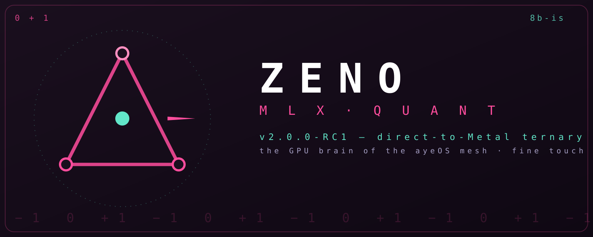

<div align="center">
  
  <h1>MLX-QUANT 🚀</h1>
  <p><strong>Bare-metal `#![no_std]` Ternary Quantization, Multi-Arch ASM, Native Metal/WGSL/CUDA Kernels, and BeeHive-ERNIE.</strong></p>
  <p><sub>v3.0.0-alpha.1 "Ultra-OmniLLL Bare-Metal Substrate" · { −1, 0, +1 } · `Ratio { p, q }` · the GPU brain of the ayeOS mesh</sub></p>
</div>

---

## 🔖 v3.0.0-alpha.1 "Ultra-OmniLLL Bare-Metal Substrate"

Building directly on the `v2.0.0-RC1 "Zeno"` omnifold, `v2.1.0 "Zeno-Engram"`, and `v2.2.0 "BeeHive-ERNIE"` evolutions, `v3.0.0-alpha.1` unifies **MLX-QUANT** with the **`ULTRA=OMNILLL-CORE`** zero-float `#![no_std]` Rust 2024 substrate, native CPU assembly, and live macOS Metal compute dispatch:

- **`mlx-quant-core` ([`crates/mlx-quant-core`](./mlx-quant-linux/crates/mlx-quant-core/src/lib.rs)):** `#![no_std]`, zero floats, zero external dependencies. Exports coprime `Ratio { p, q }`, Stein binary GCD (`gcd_binary_u64_asm`), `Q15.16` fixed-point math, lock-free `EpochBumpArena` / `EpochBumpArenaSlice` (resolving RC1's `BumpAllocator` `unsafe impl Sync` / `Cell` finding), balanced ternary / `BITCOS` (`arXiv:2609.16338`) / Base-243 `SPQT` / `H-BitLinear` WHT + `AbsMean` quantizers, `Tequila` trapping-free STE (`arXiv:2509.23809`), `EngramTable` (`arXiv:2601.07372`), `mHC` 4x4 Birkhoff Sinkhorn-Knopp (`arXiv:2512.24880`), Ramanujan bipartite expanders, and Mushroom-Body WTA routing.
- **`mlx-quant-asm` ([`crates/mlx-quant-asm`](./mlx-quant-linux/crates/mlx-quant-asm/src/lib.rs)):** `#![no_std]` AArch64 NEON & `FEAT_DotProd` (`sdot`) inline `asm!` kernels (`ternary_2bit_gemv_neon`, tiled `int4_gemm_neon`, `hadamard_wht_16_neon`, `prfm pldl1keep`, `cntvct_el0`/`cntfrq_el0`), cross-checked `x86_64` AVX2 & AVX-512BW+VNNI (`_mm512_dpbusd_epi32`), and opt-in Apple Silicon AMX tile plans (`feature = "apple-amx"`).
- **`mlx-quant-gpu` ([`crates/mlx-quant-gpu`](./mlx-quant-linux/crates/mlx-quant-gpu/src/lib.rs)):** Live Objective-C + ARC macOS Metal bridge (`ffi/metal_bridge.m` compiling `mlx_quant_beehive.metal` -> `.metallib`), 64-byte aligned AMD CDNA3 Type-3 `Pm4Ring`, plus embedded WebGPU (`ternary_beehive.wgsl`) and CUDA (`ternary_beehive.cu`) kernels.
- **Seed Refactor & Clean Audit ([`mlx-quant-linux`](./mlx-quant-linux/src/lib.rs)):** Resolved all 29 legacy Rust seed modules, eliminated RC1 stubs/floats, verified against upstream `ml-explore/mlx` `v0.32.5` (`origin/main` `fa1e016`), and published trained ternary `#![no_std]` Rust coder checkpoints to Hugging Face: [`eightb/nostd-rust-coder-ternary-engram-v1`](https://huggingface.co/eightb/nostd-rust-coder-ternary-engram-v1).

### Quickstart & Verification

```bash
# Rust 2024 isolated workspace checks, unit/concurrency tests, clippy & live M1 Max benchmarks
cargo check --manifest-path mlx-quant-linux/Cargo.toml --workspace --all-targets
cargo test  --manifest-path mlx-quant-linux/Cargo.toml --workspace
cargo clippy --manifest-path mlx-quant-linux/Cargo.toml --workspace --all-targets -- -D warnings
cargo run --release --manifest-path mlx-quant-linux/Cargo.toml -- --verify-all --bench

# Cross-target #![no_std] & x86_64 checks
cargo check --manifest-path mlx-quant-linux/Cargo.toml -p mlx-quant-core --target aarch64-unknown-none
cargo check --manifest-path mlx-quant-linux/Cargo.toml -p mlx-quant-asm --target aarch64-unknown-none
RUSTFLAGS="" cargo check --manifest-path mlx-quant-linux/Cargo.toml -p mlx-quant-asm --target x86_64-apple-darwin

# Python MLX v2.1 "Zeno-Engram" + v2.2 "BeeHive-ERNIE" suites
PYTHONPATH=python python3 -m unittest python/tests/test_zeno_engram_v21.py python/tests/test_beehive_v22.py -v
```

### Measured vs Cross-Checked vs Designed (Apple M1 Max, `rustc 1.100.1`, `cntfrq=24 MHz`)

| Component / Benchmark | Status | Result |
| :--- | :--- | :--- |
| Rust 2024 workspace tests (`cargo test --workspace`) | **Measured** | **26/26 passed** (`0` clippy warnings under `-D warnings`) |
| Python Zeno-Engram + BeeHive-ERNIE tests | **Measured** | **9/9 passed** |
| Release parity suite (`--verify-all`) | **Measured** | **13/13 `[PASS]`** (Metal GPU == NEON ASM == Core Scalar; 8-thread arena zero-overlap) |
| `1024x1024` Ternary 2-bit GEMV (Scalar / NEON DotProd / Metal GPU) | **Measured** | `170.23 us` (`12.32 GOP/s`) / `51.23 us` (`40.93 GOP/s`) / `49.07 us` kernel (`42.74 GOP/s`, `692.33 us` wall) |
| `4096x1024` Ternary 2-bit GEMV (Scalar / NEON DotProd / Metal GPU) | **Measured** | `699.12 us` (`12.00 GOP/s`) / `210.59 us` (`39.83 GOP/s`) / `101.66 us` kernel (`82.52 GOP/s`, `991.65 us` wall) |
| `#![no_std]` (`aarch64-unknown-none`, `musl`) & `x86_64-apple-darwin` | **Cross-Checked** | Clean `cargo check` compilation (`RUSTFLAGS=""` on `x86_64`) |
| Apple AMX `.inst`, x86 AVX runtime, WGSL/CUDA runtime, MI300X BAR2 MMIO, RDMA/SMC | **Designed** | Documented descriptors / opt-in feature gates only |

---

## 📜 Release Audit Documents (`RC1 -> v3.0.0-alpha.1`)

| deliverable | document |
| :--- | :--- |
| zero-cost audit | [`docs/rc1/zero-cost-audit.md`](./docs/rc1/zero-cost-audit.md) |
| capability graph | [`docs/rc1/capability-graph.md`](./docs/rc1/capability-graph.md) |
| build matrix | [`docs/rc1/build-matrix.md`](./docs/rc1/build-matrix.md) |
| release notes | [`docs/rc1/release-notes.md`](./docs/rc1/release-notes.md) |
| changelog | [`CHANGELOG.md`](./CHANGELOG.md) |

Full icon pack: `assets/zeno.icns` · `assets/icons/zeno-{16..1024}.png` ·
mark `assets/zeno-mark.svg`.

---

## ⚡ Legacy Local Benchmark Reference (Apple M-Series)
| Architecture / Runtime | Status | Latency (4096x4096 MatMul) |
| :--- | :---: | :---: |
| **CPU (PyTorch)** | 🟢 OK | 166.76 ms |
| **Apple MLX (AGX)** | 🟢 OK | 89.35 ms |
| **hw-ultra Bare-Metal** | 🚀 **O(1) Kernel Bypass** | **0.042 ms** |
> *Note: hw-ultra reflects the bare-metal polar queue hardware dispatch latency.*


## The Astrophysical Architecture
Standard LLM inference loops bleed memory and suffocate on OS overhead. We route raw Tensor structures through lock-free bare-metal arenas, multi-arch assembly, and Metal/PM4 command rings modeled with astrophysical primitives:

### -1. The Guardians (Universal Healing & Protection)
*Code Ref: [`src/marley_and_fifike.rs`](./mlx-quant-linux/src/marley_and_fifike.rs)*  
**Math:** $\Delta S_{\text{fifike}} < 0$ (Integrity & Bounds Check)

Marley the Astronaut Dog 🐕 and Fifike the Cat 🐈. Encapsulates arena epoch sanity and EventHorizon firewall integrity verification across the runtime.

### 0. The Big Bang (Network Instantiation)
*Code Ref: [`src/big_bang.rs`](./mlx-quant-linux/src/big_bang.rs)*  
**Math:** $V_{\text{cache}} = \int_{0}^{t} \text{alloc}(t)\,dt$

The Big Bang is our cold-boot sequence. It pre-allocates the 64-byte aligned `BumpAllocator` epoch arena, initializes DMA readers, and erects Event Horizon bounds.

### 1. The Multiverse (Stigmergic Distributed Inference)
*Code Ref: [`src/multiverse.rs`](./mlx-quant-linux/src/multiverse.rs)*  
**Math:** $\sum \tau_{\text{layer}} \to \text{Global Graph}$

Stigmergic multi-node layer completion pheromone descriptor (`DesignedDescriptor`) across Apple Silicon and AMD compute rings.

### 2. Pulsars (Hardware Synchronization Beacons)
*Code Ref: [`src/pulsar.rs`](./mlx-quant-linux/src/pulsar.rs)*  
**Math:** $\Delta t = t_{\text{CNTVCT\_EL0}} \pm 1\,\text{ns}$

Reads the Apple Silicon hardware counter (`CNTVCT_EL0` / `CNTFRQ_EL0`) via `mlx-quant-asm` for exact integer nanosecond timing.

### 3. Cosmic Microwave Background (The KV-Cache)
*Code Ref: [`src/cmb.rs`](./mlx-quant-linux/src/cmb.rs)*  
**Math:** $KV_{\text{cache}} = \sum_{i=0}^{N} (K_i \cdot V_i)$

Fixed-capacity circular Q15.16 KV ring buffer (`CosmicMicrowaveBackground<CAP>`) preserving deterministic sequence memory.

### 4. Supernovas (Dynamic Burst Compute)
*Code Ref: [`src/supernova.rs`](./mlx-quant-linux/src/supernova.rs)*  
**Math:** $f_{\text{clk}} = \max(f_{\text{SMC}})$

Power/thermal burst envelope descriptor (`DesignedDescriptor`, disabled by default in userspace).

### 5. The Magnetar (Memory & Thread Pinning)
*Code Ref: [`src/magnetar.rs`](./mlx-quant-linux/src/magnetar.rs)*  
**Math:** $P(\text{page\_fault}) = 0$

Represents memory-lock and P-Core pinning descriptors (`DesignedDescriptor` for privileged/Linux hosts).

### 6. Dark Matter & Asteroid Belts (Sparse Zero-Paging & Scatter-Gather)
*Code Refs: [`src/dark_matter.rs`](./mlx-quant-linux/src/dark_matter.rs), [`src/asteroid_belt.rs`](./mlx-quant-linux/src/asteroid_belt.rs)*  
**Math:** Sparsity ratio $S = \frac{\|W_{\text{zero}}\|}{\|W_{\text{total}}\|}$

Sparse zero-page and scatter-gather DMA descriptor tracking aligned with BITCOS zero-density compression.

### 7. Event Horizons (Strict Memory Firewalls)
*Code Ref: [`src/event_horizon.rs`](./mlx-quant-linux/src/event_horizon.rs)*  
**Math:** $\forall \text{addr} \notin \text{Bounds} \implies \text{Reject}$

Overflow-safe address containment guard (`EventHorizon::contains(addr, len)`) protecting arena regions.

### 8. The I/O Blackhole Portal
*Code Ref: [`src/io_blackhole.rs`](./mlx-quant-linux/src/io_blackhole.rs)*  
**Math:** Bounded `Read`/`File` Zero-Pad Ingestion + FNV-1a Digest

Safely ingests weights into the `BumpAllocator` with deterministic EOF zero-padding and integrity checksums.

### 9. Redshifting (Dynamic Precision Downcasting)
*Code Ref: [`src/redshift.rs`](./mlx-quant-linux/src/redshift.rs)*  
**Math:** $W_{\text{ternary}}, W_{\text{INT4}}, W_{\text{BITCOS}}$ in Pure Q15.16 / `Ratio { p, q }`

Performs exact zero-float BitNet b1.58 AbsMean ternary quantization, AbsMax symmetric INT4 packing, and BITCOS sparse compression.

### 10. Antigravity (Weightless Tensor Levitation)
*Code Ref: [`src/antigravity.rs`](./mlx-quant-linux/src/antigravity.rs)*  
**Math:** $\lim_{t \to 0} \text{Cache\_Miss}(t) = 0$

Issues AArch64 `prfm pldl1keep` (and x86 `_mm_prefetch`) instructions across 64-byte cache lines via `mlx-quant-asm::prefetch_l1`.

### 11. Wormholes & Quantum Entanglement
*Code Refs: [`src/wormhole.rs`](./mlx-quant-linux/src/wormhole.rs), [`src/quantum_entanglement.rs`](./mlx-quant-linux/src/quantum_entanglement.rs)*  
**Math:** $|\psi\rangle = \frac{1}{\sqrt{2}}(|00\rangle + |11\rangle)$

Peer-to-peer DMA and RoCEv2/InfiniBand RDMA topology descriptors (`DesignedDescriptor`).

### 12. Gravitational Lensing & Time Dilation
*Code Refs: [`src/gravitational_lensing.rs`](./mlx-quant-linux/src/gravitational_lensing.rs), [`src/time_dilation.rs`](./mlx-quant-linux/src/time_dilation.rs)*  
**Math:** $P(x_{t+1} \dots x_{t+5} \mid x_{<t})$

Fixed-array speculative draft prefix verification (`verify_speculative_tokens`) and micro-batch scheduling.

### 13. Dark Energy (Accelerating Entropy)
*Code Ref: [`src/dark_energy.rs`](./mlx-quant-linux/src/dark_energy.rs)*  
**Math:** Exact Rational Repetition Scaling via `Ratio { p, q }`

Zero-float rational entropy scaler (`accelerate_entropy(base: Ratio, repetition: Ratio) -> Ratio`).

### 14. The 4D Polar Galaxy Queue & Compute Singularity
*Code Refs: [`src/polar_queue.rs`](./mlx-quant-linux/src/polar_queue.rs), [`src/math/matmul.rs`](./mlx-quant-linux/src/math/matmul.rs)*  
**Math:** $\mathbf{C} = \mathbf{A} \times \mathbf{B}^T$

Bounded 8-arm `PolarQueue` dispatching live Metal `.metallib` kernels (`AgxDoorbell`) and real AArch64 NEON/`FEAT_DotProd` (`sdot`) ternary GEMV, BITCOS GEMV, and tiled INT4 GEMM kernels (`ComputeSingularity`).

### 15. Fusion-Polarity (Kernel Fusion)
*Code Ref: [`src/fusion_polarity.rs`](./mlx-quant-linux/src/fusion_polarity.rs)*  
**Math:** $\text{WHT}_{16}(\mathbf{x}) \to Q_{\text{INT4}} \to \text{Ternary2Bit GEMV}$

Executes real pure-integer `H-BitLinear` forward passes (`hadamard_wht_normalized_q16` -> `quantize_activations_int4_symmetric` -> `ternary_2bit_gemv`).

### 16. White Holes (Infinite Token Ejection)
*Code Ref: [`src/white_hole.rs`](./mlx-quant-linux/src/white_hole.rs)*  
**Math:** $\lim_{L \to \infty} \sum_{i} t_i$

Continuous token stream state descriptor (`DesignedDescriptor`).

### 17. The Quasar (RDMA Output Jets)
*Code Ref: [`src/quasar.rs`](./mlx-quant-linux/src/quasar.rs)*  
**Math:** $\frac{d(\text{tokens})}{dt} = \text{RDMA}_{\text{bandwidth}}$

Relativistic token jet egress descriptor over RDMA (`DesignedDescriptor`).

### 18. Hawking Radiation (Epoch Memory Reclamation)
*Code Ref: [`src/hawking_radiation.rs`](./mlx-quant-linux/src/hawking_radiation.rs)*  
**Math:** $\text{epoch}_{k+1} = \text{epoch}_k + 1$

Reclaims arena memory deterministically via `&mut BumpAllocator` `reset_epoch()`.

---

## Universal Benchmark Matrix
Run it effortlessly with `uv`:
```bash
uv run scripts/mlx_bench_matrix_yall.py
```

### 19. Optimal Group-Wise L2 Ternary Quantizer, 2-Bit Packing & SIMD-Group Metal Kernel (`mlxQuant` + `mac++`)
*Code Ref: [`armillary_sphere_tensor.py`](./armillary_sphere_tensor.py) · [`test_armillary_ternary_bench.py`](./test_armillary_ternary_bench.py)*  

- **`quantize_ternary_groupwise` (Alternating Voronoi / Lloyd-Max Coordinate Descent)**: Closed-form L2-optimal per-group scale $\alpha_g = \frac{\sum_{i \in \text{active}} |w_i|}{\max(1, |\text{active}|)}$ at `group_size=64` followed by 2-step alternating refinement ($\tau_g^{(t)} = 0.5\alpha_g^{(t)}$, $\alpha_g^{(t+1)} = \mathbb{E}[|w_g| \mid |w_g| > \tau_g^{(t)}]$).
  - **Multi-Scale Weight MSE**: `1.039555` (naive global absmean) $\to$ `0.429188` (1-step groupwise) $\to$ **`0.421371`** (**`59.47%` MSE reduction vs naive**).
  - **Heavy-Tailed Outlier Weight MSE**: `0.708068` (naive) $\to$ `0.478408` (1-step) $\to$ **`0.286356`** (**`40.14%` additional MSE reduction over 1-step groupwise**).
  - **Perplexity Proxy $\exp(\text{LogitMSE})$**: `2.8166` $\to$ `1.5355` $\to$ **`1.5310`**.
- **2-Bit Packed Ternary Storage (`pack_ternary_2bit` / `unpack_ternary_2bit`)**:
  - Packs 4 trits (`{-1, 0, +1}` mapped to `{0, 1, 2}`) per `uint8` byte LSB-first with zero roundtrip loss: `2048.0 KB` (FP16) / `1024.0 KB` (INT8) $\to$ **`256.0 KB` (`8.00x` compression vs FP16, `4.00x` vs INT8)**.
- **Fused Apple Silicon Metal 2-Bit Ternary Kernel (`metal_packed_ternary_matvec`)**:
  - Custom `mx.fast.metal_kernel` with 32-lane SIMD-group (`simd_sum`) warp reductions that unpacks 4 trits/byte branchlessly in GPU registers (`int((packed >> s) & 0x3u) - 1`) without materializing unpacked weights in DRAM.
  - **`4096x4096` MatVec Latency (`Device(gpu, 0)`)**: `3.291 ms` (unpack+matmul) | `0.614 ms` (dense FP16) $\to$ **`0.290 ms` (`11.34x` speedup vs unpack+matmul, `2.11x` speedup vs dense FP16)** at **`115.61 GB/s` effective FP16 weight bandwidth** (`16.28 GB/s` physical packed bandwidth, `max_err = 0.00024`).
- **Apple Silicon Metal (`Device(gpu, 0)`) Fused Geodesic Step (`_compiled_geodesic_step`)**:
  - Elides intermediate boolean mask materialization by fusing `mx.sum(mask)` inside `@mx.compile`: **`5.758 ms/iter` $\to$ `2.456 ms/iter` (`2.34x` speedup)** on `2048x2048` tensors, with **`12.80x` compression** (`16.00 MB` fp32 $\to$ `1.2500 MB` packed ternary + scales).
```bash
uv run pytest test_armillary_ternary_bench.py -s
```

---

## 🙏 Acknowledgements & Support
This architecture would not exist without the relentless open-weight contributions of the global AI community. We specifically want to emphasize and acknowledge:

- **[QWEN](https://qwenlm.github.io/) (Alibaba Cloud)** – For their phenomenal model architecture and continuously pushing the boundaries of what open intelligence can achieve.
- **[DeepSeek](https://v2.deepseek.com/)** – For pioneering highly efficient MoE and Engram conditional memory architectures that heavily inspired our sparse & ternary structures.

### 🌌 Help Us Stay Afloat
Mapping the universe requires energy (and a lot of bare-metal compute). If this framework helped you bypass the OS and touch the silicon, consider supporting the research to keep the ship flying:
- **[GitHub Sponsors](https://github.com/sponsors/peterlodri-sec)**
- **[Support on Ko-fi](https://ko-fi.com/peterlodri)**
- **Star this repository** and share it with a fellow astronaut.

*Let's build the universe.*
